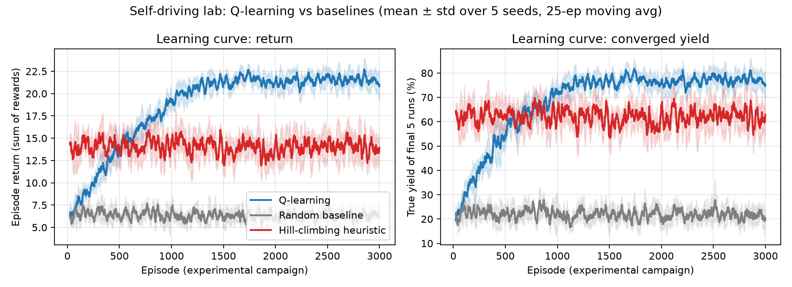
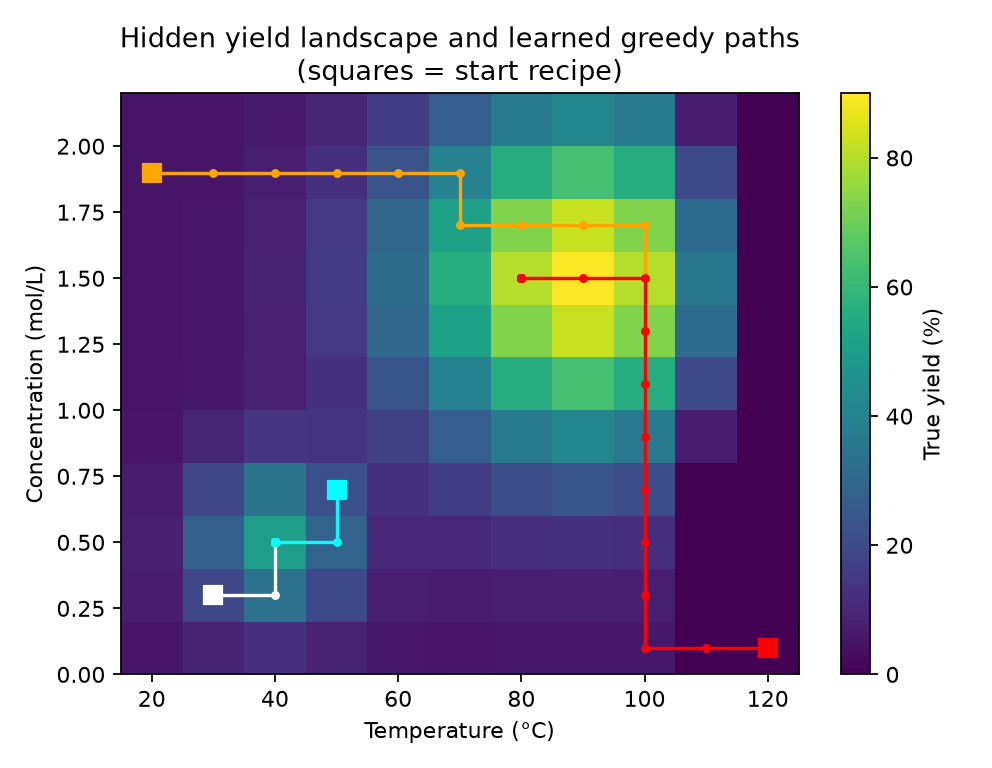
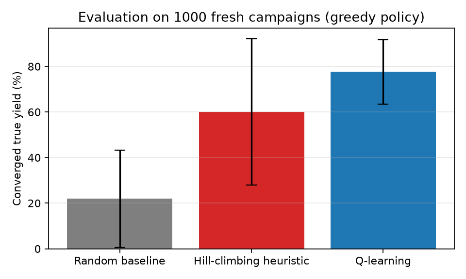

# RL Assignment — Project 7: Self-Driving Lab Simulator

Unit 5 Reinforcement Learning homework. A tabular **Q-learning** agent learns which reaction
conditions (temperature and concentration) to try next in a simulated chemistry lab, so as to
maximise product yield within a fixed budget of 30 experiments.

## Problem formulation

| Element | Definition |
|---|---|
| Environment | Simulated reaction with a hidden yield surface: global optimum ≈ 90 °C / 1.5 M (≈90 % yield), decoy local optimum ≈ 40 °C / 0.5 M (≈50 %), product decomposition above 100 °C, measurement noise σ = 3 % |
| State | Current recipe on an 11 × 11 grid — T ∈ {20 … 120} °C, C ∈ {0.1 … 2.1} mol/L |
| Actions | T ±10 °C, C ±0.2 M, repeat current recipe (5 actions) |
| Reward | measured yield / 100 − 0.05 · max(0, (T − 80) / 40) (energy/safety cost for hot runs) |
| Episode | One campaign of 30 experiments from a random starting recipe |

**Algorithm:** tabular Q-learning, γ = 0.97, ε-greedy (1.0 → 0.05 over 1500 episodes),
step size α = max(0.02, 0.5/√N(s,a)), 3000 training episodes × 5 seeds.

**Baselines:** random policy and a greedy hill-climbing heuristic.

## Results (1000 evaluation campaigns, greedy policy)

| Method | Converged yield | Reached global optimum |
|---|---|---|
| Random | 22.0 % | 4 % |
| Hill-climbing heuristic | 60.1 % | 54 % |
| **Q-learning** | **77.6 %** | **80 %** |







## Run it

```bash
pip install -r requirements.txt
python lab_rl.py       # trains + evaluates, writes figures and results.json to out/ (~2 min)
python build_docs.py   # optional: builds the report (.docx) and slides (.pptx) from the results
```
